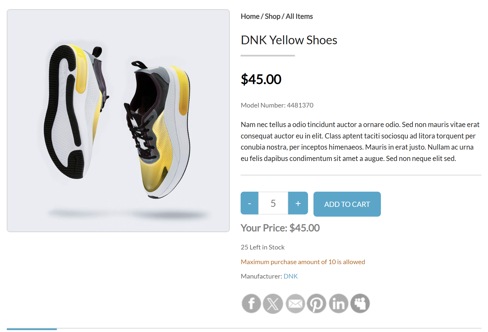
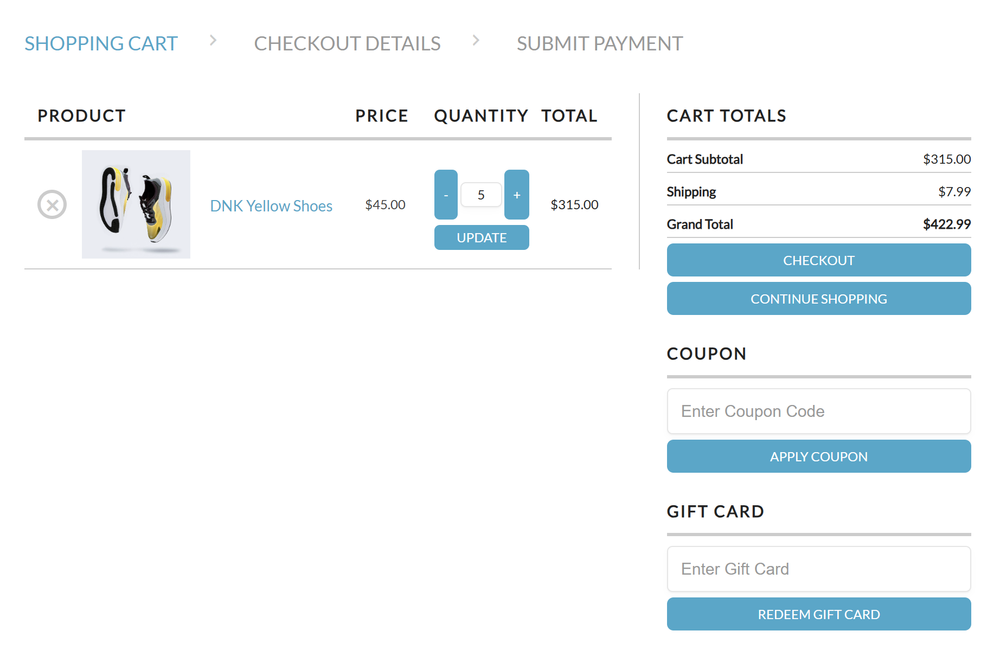
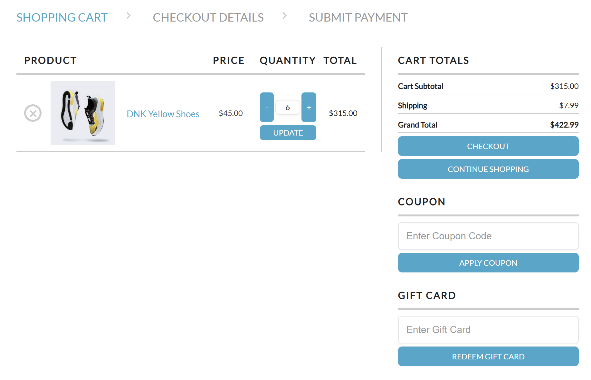
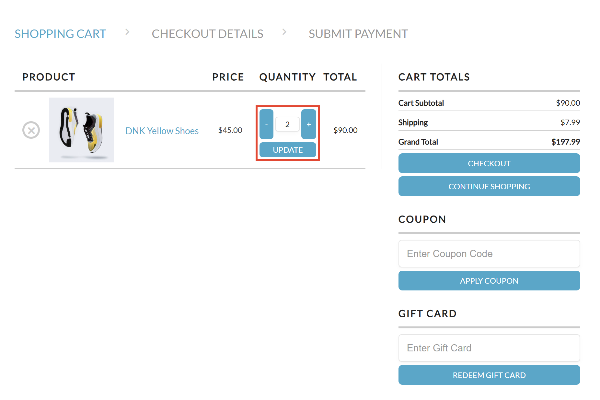

# BR-004: Shopping Cart Quantity Resets to 2 After Clicking UPDATE

## Environment

- OS: Windows 11
- Browser: Google Chrome
- Website: AcademyBugs
- Product: DNK Yellow Shoes

## Preconditions

- The shopping cart is empty.
- The product is available for purchase.
- The maximum allowed purchase quantity is 10.

## Steps to Reproduce

1. Open the product details page for DNK Yellow Shoes.
2. Set the product quantity to 5.
3. Click ADD TO CART.
4. Open the shopping cart.
5. Change the quantity from 5 to 6.
6. Click the UPDATE button.

## Expected Result

The shopping cart should update the product quantity to 6.

The product subtotal should be $270.00.

## Actual Result

After clicking the UPDATE button, the product quantity resets to 2.

The product subtotal changes to $90.00.

## Severity

Major (Provisional)

## Priority

High (Provisional)

## Status

Reproduced - Ready for Review

## Evidence

### 1. Product quantity set to 5

### 2. Shopping cart displays quantity 5

### 3. Quantity changed from 5 to 6

### 4. Quantity resets to 2 after UPDATE

## Additional Notes

The product details page allows quantities from 1 to 10.

The shopping cart does not retain the requested quantity after clicking UPDATE.

The incorrect cart grand total has been documented separately in BR-001.