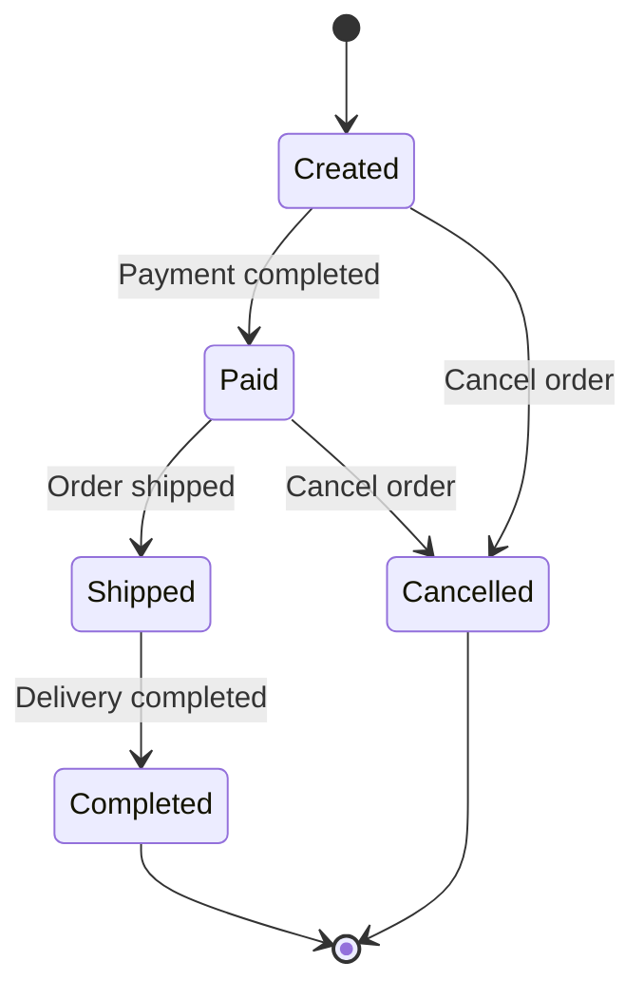

# Day 18 - State Transition Testing

## Test Objective

Verify valid and invalid order state transitions based on simulated business rules.

## Business Rules (Simulated)

1. An order must be paid before it can be shipped.
2. A shipped order can be marked as completed.
3. Orders in Created or Paid status can be cancelled.
4. Orders in Shipped or Completed status cannot be cancelled.

## Order State Diagram

## Invalid State Transition Test Design

| ID | Current State | Event | Attempted Next State | Expected State | Expected Behavior |
| --- | --- | --- | --- | --- | --- |
| IT-01 | Shipped | Cancel order | Cancelled | Shipped | Cancellation rejected |
| IT-02 | Created | Ship order | Shipped | Created | Shipment rejected |
| IT-03 | Completed | Cancel order | Cancelled | Completed | Cancellation rejected |

## Test Execution Summary

### Test Website

https://the-internet.herokuapp.com/dynamic_controls

### Verified Scenarios

| Scenario ID | State Transition | Status |
|---|---|---|
| SC-031 | Disabled to Enabled | Pass |
| SC-032 | Enabled to Disabled | Pass |
| SC-033 | Checkbox Present to Removed to Present | Pass |

### Execution Scope

The order state diagram and invalid transition cases were designed using simulated business rules.

The simulated order transitions were not executed on the test website.

The three executed scenarios tested actual UI state changes on the Dynamic Controls page.

### Bug Report

No confirmed bug was identified during these tests.

BR-011 was not created.
